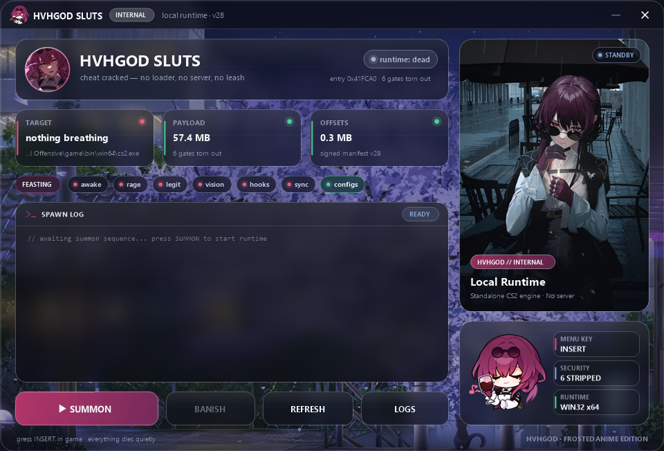
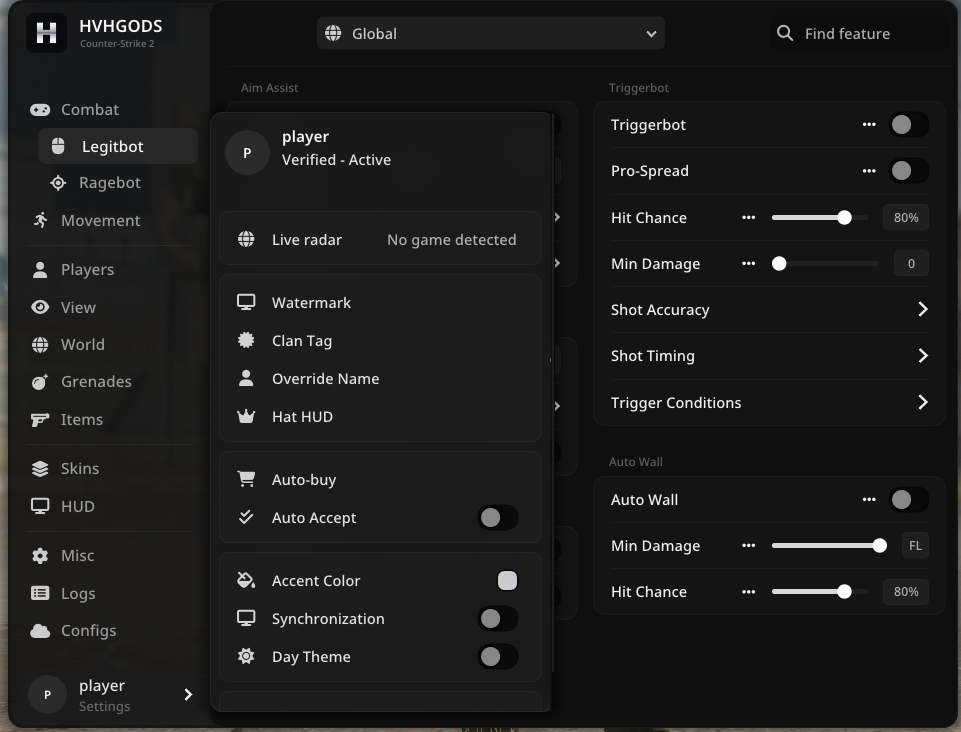

# HVHGOD SLUTS — standalone internal, cracked, free, no bullshit

**The cheat itself is in this repo. `payload\payload.clean.dll`, 60,192,400
bytes, committed, sitting right there in the tree.** No release scavenger hunt,
no "check the pinned message", no dead Discord invite from a guy who calls
himself a "provider". Clone it, build it, play. That is the entire flow, you
lazy fucks.

A cracked, serverless build of the HVHGOD internal for Counter-Strike 2. No
loader, no account, no subscription, no vendor backend sniffing your machine, no
telemetry. The whole thing is here: the binary, the launcher, the mapper, the
patcher, the pipeline, the docs. Take it, build it, play.

No payment. No whitelist. No "contact me on telegram". The vendor sells this for
money and bans you for sharing it — so here it is, binary and all, for everyone
who can't or won't pay for a cheat that runs on their own fucking computer.

> It is cheat software. It injects into `cs2.exe`, it is unsigned, and VAC bans
> are permanent and hardware-linked. Read [docs/TROUBLESHOOTING.md](docs/TROUBLESHOOTING.md)
> before you drag it onto a VAC-secured server, and eat the first test on an
> account you do not mind losing. That is not a warning label for show — the
> machine does what the machine does, and no amount of crying in a forum
> changes that.

## Screenshots

The launcher:



The loading card that sits over the game while the pipeline does real work
(preflight → staging → launch → map → imports → attach → verify):


The menu in game — legitbot, triggerbot, auto wall:


Profile panel, radar, watermark, clan tag, accent colour, day theme:



The numbers on the loading card are not a fake animation for smoothbrains who
need a progress bar to feel something. `run-standalone.ps1` writes a progress
file at every real stage and the overlay reads it — see
`tools/overlay/overlay.cpp` and `work/progress.txt` in the pipeline.

## What it does

| Stage | What happens |
|---|---|
| Launch | opens the game through Steam (`steam://rungameid/730`), waits for the engine |
| Map | maps a patched copy of the internal image into `cs2.exe` with a manual PE mapper |
| Repair | rewrites the import slots the mapper cannot fill (`d2d1`, the Configs crash), then clears the DOS magic |
| Attach | invokes the image entry point with the handshake block |
| Verify | reads the runtime's own logs and tells you the truth |

## Requirements

- Windows 10 19044+ or Windows 11, x64
- Steam and Counter-Strike 2
- PowerShell 7 — `winget install Microsoft.PowerShell`
- Visual Studio 2022 BuildTools with the Desktop C++ workload —
  `winget install Microsoft.VisualStudio.2022.BuildTools`

Nothing is prebuilt except the closed-source image the vendor already compiled.
`build.ps1` compiles the rest with `cl /W4`. If you can't compile four small
tools on your own machine, this isn't for you — go buy the subscription and get
fleeced like the rest of the paste-eaters.

## Quick start

```
1. git clone this repo
2. pwsh -File build.ps1
3. launcher\bin\hvhgod-launcher.exe
```

The 60 MB payload is already in `payload\` because it is committed to the
branch. There is no step 0, no download link, no "asset missing" whining. If
`payload\payload.clean.dll` isn't there, you cloned like a headless chicken —
clone the right repo.

Press **SUMMON**. Watch the loading card. Press **INSERT** in game.

Only want the tools, not the 60 MB strip pass?

```
pwsh -File build.ps1 -NoPayload
```

## Known shit that does not work

Being honest instead of pretending:

- **Configs in-game are broken.** The Configs tab loads and the profiles list is
  empty, and saving from the menu does not stick. The runtime expects the config
  library to be handed to it by the vendor loader over an in-process callback; we
  killed that callback to run without the loader, so the menu has no source for
  the list. Files in `%LOCALAPPDATA%\HVHGOD\CS2 Runtime\Internal\Bridge\Configuration\`
  exist but the tab does not populate from them reliably.
  **Workaround:** the runtime still writes `loaded-profile.json` on exit — settings
  that were already loaded stay loaded for that session. Do not expect to switch
  profiles mid-match. Cope.
- **Offsets are pinned to a CS2 build.** After a game update, replace
  `data\offsets.genuine.bridge`. The six patches do not change; the offsets do.
  A game update is not the repo's fault, so don't open an issue about it like it
  is a personal betrayal.
- **No vendor account features.** Anything that needed the HVHGOD backend —
  cloud configs, subscription status, injected user data — is dead. That was the
  point. If you wanted the subscription anyway, nobody is stopping you from
  paying twice for the same binary.
- **Four optional feature hooks report unavailable.** The runtime says
  `optional_unavailable=4`. Everything else initialises.
- **Unsigned.** Defender, SmartScreen and every AV on earth will scream. It
  injects into another process; of course it will. Whining to me about a false
  positive is a waste of both our lives.

## What works

Verified on a live session, not claimed by some dickhead in a Telegram channel:

```
INITIALIZATION_SUCCESS  state=loader_signaled core=validated render_input=ready
RAGE_BOT_INIT_SUCCESS   state=hooks_active
LEGIT_BOT_INIT_SUCCESS  state=hooks_active
RENDER_RUNTIME_READY    backend=ready fonts=ready window_input=ready
MENU_INPUT_OWNERSHIP_ACQUIRED
```

Rage bot, legit bot, ESP, antiaim, skin changer, movement, world visuals — the
whole internal, because the whole internal is inside the binary that is now
sitting in your checkout. We didn't write a cheat, we removed a licence check.
That's it. That's the entire heist.

## How it works (short version)

The internal image gates every feature on one byte. Six patches turn the
permission request into a constant:

```
0x001950  delivery verifier        mov al,1 ; ret
0x0A9120  bridge init              mov al,1 ; ret
0x166F60  process binding          mov al,1 ; ret
0x0E5780  lease watchdog           ret
0x41F290  unload/disable routine   ret
0x0E4230  AUTH + readiness seeds   3 byte writes + mov al,1 ; ret
```

35 bytes change out of 60,192,400. Everything else is the vendor's code,
untouched. Sixty megabytes of paid software, undone with thirty-five bytes and a
free afternoon. The long version with every RVA and crash analysis is in
[docs/ARCHITECTURE.md](docs/ARCHITECTURE.md).

The internal image itself is closed source. There is no C++ source for it
anywhere, and none was used here — stop asking for the "real source", it does
not exist, the vendor never gave it to anyone. A Ghidra reconstruction is
published as `decompiled-reference.zip` — 11,150 functions, useful for reading,
does not compile, is not the original. See [docs/DECOMPILED.md](docs/DECOMPILED.md).

## Configs are yours, on your machine

```
%LOCALAPPDATA%\HVHGOD\CS2 Runtime\Internal\Bridge\Configuration\config-library.bridge
```

Nothing in this repo ships a config library. Every machine starts empty and keeps
its own. The file is gitignored; your profiles never leave your PC, and nobody
here wants your dogshit crosshair settings anyway.

## Command line

```powershell
pwsh -File work\run-standalone.ps1
pwsh -File work\run-standalone.ps1 -BootSeconds 30 -WatchMinutes 2
```

`-DirectLaunch` starts `cs2.exe` without Steam. Debug only — VAC refuses secure
servers for a game that isn't part of Steam's launch chain. That is exactly the
"no signatures" dialog you get if you skip Steam, and no, there is no clever
trick around it, so put the idea down.

## Building from source

```powershell
pwsh -File build.ps1            # strip payload + compile launcher/iatfix/caller/overlay + clean scan
pwsh -File build.ps1 -NoPayload # tools only
```

Layout:

```
payload\       payload.clean.dll (60 MB, committed) + readme
launcher\      Win32 launcher (source + build.bat)
loader\        XMap.cs — manual PE mapper
work\          run-standalone.ps1 — the pipeline
tools\         strip_gates.ps1, bytepatch.ps1, gates.json, iatfix, caller, overlay, ghidra, check-clean
data\          signed offsets manifest
docs\          architecture, troubleshooting, decompiled notes
```

Want to tweak the binary yourself? `tools\bytepatch.ps1` applies any byte edit
from a JSON list with an `expect` check, and `tools\gates.json` shows the six
patches as data. That's how you start modifying functions without source —
poke it, break it, fix it, that's called learning.

## Donate — fund more of this

```
bc1qxgr0etjnvf733nqcad9wmrdjtl7gfcnjsewht8
```

That is a Bitcoin address. Every sat goes to cracking, documenting and releasing
more cheats like this one — no paywalls, no reseller scum, no "premium tier".

What your coins buy:

- more payloads reversed and released
- more loaders replaced with open launchers
- better decompiled references
- tooling that makes the next one faster

If this saved you money, send something back. If you're broke, use it anyway and
share it with someone else who's broke. That's the whole point. If you're a
reseller selling this exact tree back to kids at 20 bucks a month — you are the
reason this exists, and you can go fuck yourself sideways.

## Contributing

Pull requests welcome. Before opening one:

```powershell
pwsh -File build.ps1 -NoPayload
pwsh -File tools\check-clean.ps1   # must print "clean"
```

`check-clean.ps1` blocks absolute user paths, config libraries and captured
credentials. CI runs the same check plus a PowerShell parse pass. If your PR
turns the badge red, you didn't read this paragraph, and you deserve the shame.

## No licence

There is no licence file. Do whatever you want with the code in this repository:
fork it, rewrite it, ship it, sell it, claim you wrote it — I genuinely do not
care, and I am not going to pretend to be a lawyer about a cheat. The internal
image (`payload.clean.dll`) is third-party software and is not mine to license
either way; it ships in this repo so nobody has to beg for a download link.

## Final word

The vendor charges a subscription to flip six booleans in a binary you already
downloaded, and then calls that a product. Fuck that, and fuck every reseller
who gatekeeps a file that costs them nothing to copy. The binary is in the tree.
The patches are in `tools\gates.json`. The docs are in `docs\`. Compile it, play
it, hand it to the next broke bastard who just wants to play the game.
