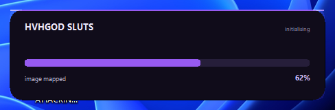
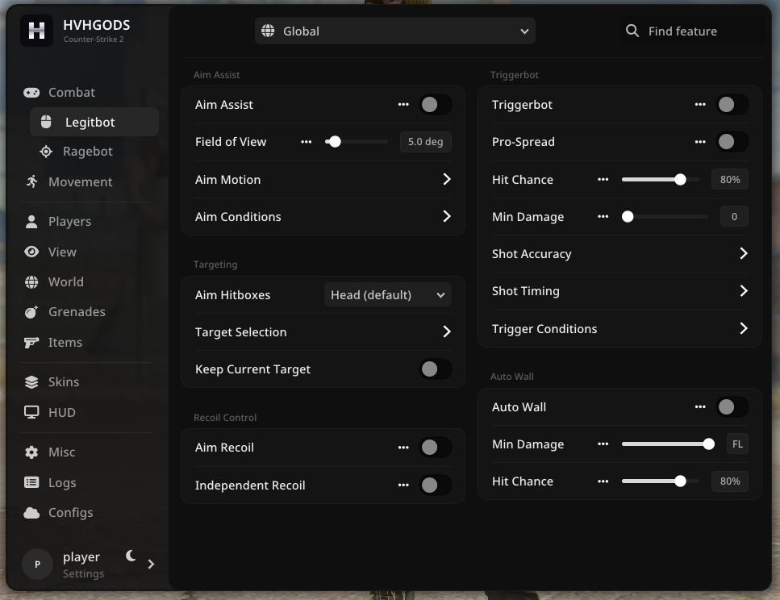

<div align="center">

# HVHGOD SLUTS

**Cracked, serverless internal build for Counter-Strike 2**  
*60 MB payload · Frosted Anime Launcher · Manual PE mapper · 6 licence gates stripped · 11,150 decompiled functions*


[Features & Status](#status) · [Screenshots](#screenshots) · [Quick Start](#install-and-start) · [VAC Stealth](#stealth-what-it-does-against-vac) · [Logs & Offsets](#logs-offsets-command-line) · [Build](#build-from-source) · [Donate](#donate)

</div>

---

Clone it, build it, play. No account, no subscription, no vendor server, and no reseller selling a file that costs nothing to copy.

> [!IMPORTANT]
> ## STATUS
>
> **Rage bot works in this build.** Ungating the module was only half of it; the aim path checks `image+0xCAD2E0` (master) and `image+0xC7E1F0` (autofire) on every command and bails with `reason=rage_inactive` when zero. The pipeline seeds both at attach (step 5d, `tools\rage_seed.ps1`), so **rage is active by default** unless you pass `-NoRageSeed`.
>
> **Legit bot accepts rage-grade numbers.** Smoothing `0–2`, FOV `90–180`, head-only, autofire `0 ms` — see the [settings table](#legit-bot-with-rage-numbers).
>
> **Donations — Bitcoin only.** BTC on the Bitcoin network only (no USDT, ETH, BEP20, or wrapped tokens):
> ```text
> bc1qxgr0etjnvf733nqcad9wmrdjtl7gfcnjsewht8
> ```

---

## Contents

- [What you get](#what-you-get)
- [Screenshots](#screenshots)
- [Requirements](#requirements)
- [Install and start](#install-and-start)
- [Stealth: what it does against VAC](#stealth-what-it-does-against-vac)
- [Legit bot with rage numbers](#legit-bot-with-rage-numbers)
- [Logs, offsets, command line](#logs-offsets-command-line)
- [What is broken](#what-is-broken)
- [Troubleshooting](#troubleshooting)
- [Build from source](#build-from-source)
- [Donate](#donate)

---

## What you get

| Path | What it is |
|---|---|
| `payload\payload.clean.dll` | Original internal image, 60,192,400 bytes, committed |
| `decompiled\00` .. `06` | 11,150 Ghidra-decompiled functions, one `FUN_<address>.c` per file |
| `launcher\src\launcher.cpp` | Win32 / GDI+ launcher with Frosted Anime Glass UI & live state monitor |
| `launcher\src\anime_assets.h` | Embedded anime artworks & transparent chibi assets (zero external runtime files) |
| `loader\XMap.cs` | Manual PE mapper: relocations, imports, `.pdata`, TLS |
| `work\run-standalone.ps1` | Full pipeline: preflight, stage, launch, map, repair, scrub, attach, verify |
| `tools\strip_gates.ps1` + `tools\gates.json` | The six licence patches, as code and as data |
| `tools\bytepatch.ps1` | Arbitrary byte edit from a JSON list, with an expect-check |
| `tools\stealth.ps1` | Scan a live process for tells, scrub the mapped header band |
| `tools\rage_seed.ps1` | Seed the two config flags checked by the rage aim path (master + autofire) |
| `tools\scrub_image.ps1` | Strip Rich header, timestamp, section names, PDB path |
| `tools\iatfix`, `tools\caller`, `tools\overlay` | Import repair, entry caller, and live loading overlay |
| `data\offsets.genuine.bridge` | Signed offsets manifest, 3,071 entries |
| `docs\` | Architecture, decompiled notes, VAC threat model, troubleshooting |

It is the vendor's binary with six booleans forced true. It is not a cheat written here, and the decompiled tree is not the original compilable source.

---

## Screenshots

**Launcher — Frosted Anime Glass UI, live status cards, feature chips, and `SPAWN LOG`:**


**In-game loading overlay — real-time progress read from `work\progress.txt` (preflight → staging → launch → map → imports → attach → scrub → verify):**



**In-game menu — legitbot, triggerbot, auto wall (rage flags are seeded automatically on attach unless `-NoRageSeed` is used):**



**Profile panel — radar, watermark, clan tag, accent colour, day theme:**


---

## Requirements

- **OS:** Windows 10 (19044+) or Windows 11, x64
- **Game:** Steam signed in, Counter-Strike 2 installed
- **PowerShell 7:** `winget install Microsoft.PowerShell`
- **MSVC Toolchain:** Visual Studio 2022 BuildTools (Desktop C++ workload) — `winget install Microsoft.VisualStudio.2022.BuildTools`

---

## Install and start

```powershell
# 1. Clone — the payload is inside, nothing extra to download
git clone https://github.com/crackallergicaleinstein/HVHGOD-paid-cheat-free-forever-.git
cd HVHGOD-paid-cheat-free-forever-

# 2. Build — strips licence gates, scrubs metadata, compiles all 4 native tools
pwsh -File build.ps1

# 3. Run the launcher
.\launcher\bin\hvhgod-launcher.exe
```

`build.ps1` finishes with:

```text
[build] payload.stripped.dll 60,192,400 bytes
[scrub] vendor metadata removed
[build] launcher / iatfix / caller / overlay  ... bytes
[check-clean] clean - no personal paths, no configs, no credentials
[build] ready
```

> [!TIP]
> To compile only the native tools without re-stripping the payload: `pwsh -File build.ps1 -NoPayload`

### Using the launcher

1. **Check the status cards & chips:** `TARGET`, `PAYLOAD`, `OFFSETS` cards and the `FEASTING` chips (`awake`, `rage`, `legit`, `vision`, `hooks`, `sync`, `configs`). The badge switches from `STANDBY` to `TARGET LIVE` once CS2 is active.
2. **Press `SUMMON`:** Launches CS2 via Steam, waits for the engine, maps the scrubbed image, repairs imports, wipes the DOS magic, scrubs the mapped header band, arms the TLS sweep, seeds rage flags, and tails the live runtime log.
3. **Press `INSERT` in game:** Opens the in-game menu.
4. **Press `BANISH` before closing:** Unloads and releases the mapping cleanly.

| Control | Action |
|---|---|
| `SUMMON` | Full pipeline: Steam launch → map → repair → scrub → attach → seed → verify |
| `BANISH` | Unload, release the mapping, stop the runtime |
| `REFRESH` | Re-run preflight checks and refresh live state |
| `LOGS` | Open the runtime log directory in Explorer |

### Headless CLI pipeline (without launcher GUI)

```powershell
pwsh -File work\run-standalone.ps1
pwsh -File work\run-standalone.ps1 -BootSeconds 30 -WatchMinutes 2
pwsh -File work\run-standalone.ps1 -NoStealth      # skip scrub, debugging only
```

`-DirectLaunch` starts `cs2.exe` without Steam — VAC replies with `"no signatures"` and refuses secure servers. Debug only.

---

## Stealth: what it does against VAC

Two different things get called a ban. Only one is code.

| Caught by | What it is | Handled here |
|---|---|---|
| Memory scan | RWX pages, PE header in private memory, module-less threads, vendor metadata | **Yes** |
| Demo / behaviour | 0 smoothing, 180 FOV, 0 ms autofire in a real match | **No** — that is your config |

All stealth layers are enabled by default:

1. **Manual mapping, no `LDR` entry** — the image never appears in the PEB module list, so module enumeration misses it.
2. **Real section protections** — never RWX at rest; each section gets its own `PAGE_*` protection.
3. **Stubs are RW, then RX, then freed** — `loader\XMap.cs` and `tools\caller\caller.cpp` leave no private executable page or RWX window behind.
4. **DOS magic wiped after attach** — `tools\iatfix` clears the cheapest "PE in private memory" heuristic.
5. **Whole header band scrubbed after attach** — `tools\stealth.ps1` zeroes the NT header, section table, import names, and debug record, then marks the page read-only.
6. **Vendor metadata gone before mapping** — `tools\scrub_image.ps1` zeroes the Rich header, linker timestamp, checksum, section names, and PDB path.
7. **Live scan report at the end** — step 8 prints every region a scanner would still flag into `work\pipeline.log`.

Verify manually while the runtime is up:

```powershell
pwsh -File tools\stealth.ps1 -Pid <cs2 pid>
# clean: no private executable regions, no RWX, no PE header outside image mappings
```

Any line with `rwx`, `MZ`, or `private` is a tell that survived. What it does **not** do: defeat static code signatures inside the mapping or hide blatant rage settings in demos. Full threat model: [docs/VAC.md](docs/VAC.md).

---

## Legit bot with rage numbers

`INSERT` → **Legit** tab:

| Setting | Default | Aggressive / Rage-like |
|---|---|---|
| Smoothing | 25–40 | **0–2** |
| FOV | 4–12 | **90–180** |
| Hit group | nearest / body | **head** |
| Autofire delay | 50–150 ms | **0 ms** |
| Backtrack | off / 3 | **max** |
| Trigger delay | 60+ ms | **0 ms** |
| Trigger hitchance | 40 | **80–100** |

For safer match longevity, use `3–8` smoothing and `20–40` FOV.

---

## Logs, offsets, command line

```text
%LOCALAPPDATA%\HVHGOD\CS2 Runtime\Internal\Logs\
```

| File | Content |
|---|---|
| `Lifecycle\runtime.log` | Init and lifecycle events |
| `Bridge\bridge.log` | Feature handshake |
| `Misc\features.log` | Feature bindings |
| `Crashes\errors.log` | `NATIVE_EXCEPTION` records with `location=` offsets |
| `work\pipeline.log` | Full pipeline output |

A healthy attach prints:

```text
INITIALIZATION_SUCCESS  state=loader_signaled core=validated render_input=ready
LEGIT_BOT_INIT_SUCCESS  state=hooks_active
RENDER_RUNTIME_READY    backend=ready fonts=ready window_input=ready
MENU_INPUT_OWNERSHIP_ACQUIRED
```

If rage does nothing, check `Ragebot\rage.log` or verify step 5d (`tools\rage_seed.ps1`) ran.

Offsets live in `data\offsets.genuine.bridge` and are staged to `%LOCALAPPDATA%\HVHGOD\CS2 Runtime\Internal\Bridge\Offsets\offsets.bridge`. After a CS2 update, replace the manifest — the six patches are build-independent.

> [!WARNING]
> **The committed manifest is stale.** `offsets.genuine.bridge` describes
> `client.dll` sha256 `99a6720b…` (built 2026-11-11). The current game ships
> `07103341…` (build 14200, 2026-11-20), so every RVA in it is wrong — see
> [`docs/OFFSETS.md`](docs/OFFSETS.md). `data\offsets.current.bridge` carries
> live-resolved addresses for the current build and is what the standalone SDK
> consumes. Regenerate it with `pwsh -File sdk\tools\make-manifest.ps1` after
> each game update.

### The six patches (35 bytes out of 60,192,400)

```text
0x001950  delivery verifier        mov al,1 ; ret
0x0A9120  bridge init              mov al,1 ; ret
0x166F60  process binding          mov al,1 ; ret
0x0E5780  lease watchdog           ret
0x41F290  unload/disable routine   ret
0x0E4230  AUTH + readiness seeds   3 byte writes + mov al,1 ; ret
```

Details: [docs/ARCHITECTURE.md](docs/ARCHITECTURE.md).

Custom binary patching:

```powershell
Get-Content decompiled\00\FUN_1800e4230.c
pwsh -File tools\bytepatch.ps1 -List my-patches.json -In payload\payload.clean.dll -Out work\payload.stripped.dll
```

---

## What is broken / limitations

- **Rage bot flags:** The module is ungated, but relies on the two config flags seeded automatically by the pipeline in step 5d (`tools\rage_seed.ps1`).
- **In-game Configs tab:** Profile list is empty and saving does not stick (the vendor loader callback no longer exists). `loaded-profile.json` is still written on exit.
- **CS2 version pinning:** Replace `data\offsets.genuine.bridge` after major game updates.
- **No vendor cloud features:** Cloud configs, subscriptions, and server telemetry are permanently dead.
- **Unsigned binaries:** Antivirus software will flag memory injection tools — add a repo folder exclusion if needed.

---

## Troubleshooting

| Symptom | Fix |
|---|---|
| Rage bot does nothing | Run `pwsh -File tools\rage_seed.ps1 -ProcessId <pid> -Base <base>` — [details](docs/TROUBLESHOOTING.md) |
| Banned fast in a real match | Demo/behaviour ban, not the mapper — [docs/VAC.md](docs/VAC.md) |
| VAC: "no signatures or invalid signatures" | Launch through Steam, never `-DirectLaunch` |
| "cs2 never appeared" | Start CS2 once from Steam library, then retry |
| "access denied" mapping | Steam is elevated — run `hvhgod-launcher.exe` as administrator |
| Runtime initialises, then unloads | Press `BANISH`, wait two seconds, press `SUMMON` |
| "runtime did not become ready" | Check `Lifecycle\runtime.log` and `Crashes\errors.log` |
| Configs tab crashes | `iatfix` did not run — look for `iatfix: N slots repaired` |
| Features dead after CS2 update | Replace `data\offsets.genuine.bridge` |
| Game empty, chips green | Press `INSERT` and check the feature master toggle |

Full troubleshooting reference: [docs/TROUBLESHOOTING.md](docs/TROUBLESHOOTING.md).

---

## Build from source

```powershell
pwsh -File build.ps1            # strip + scrub + compile all tools + clean scan
pwsh -File build.ps1 -NoPayload # native tools only
```

```text
payload\       payload.clean.dll (60 MB)
decompiled\    approximate Ghidra output, one file per function
launcher\      Win32 / GDI+ Frosted Anime launcher
loader\        XMap.cs manual PE mapper
work\          run-standalone.ps1 pipeline
tools\         strip_gates, bytepatch, gates.json, iatfix, caller, overlay, ghidra, split_decomp, stealth, scrub_image, check-clean
data\          signed offsets manifest
docs\          architecture, VAC, decompiled notes, troubleshooting, screenshots
```

---

## Donate

**Bitcoin only.** This address only accepts BTC on the Bitcoin network (no USDT, ETH, TRX, or BEP20 wrapped tokens).

```text
bc1qxgr0etjnvf733nqcad9wmrdjtl7gfcnjsewht8
```

Every sat goes toward resolver updates and future releases. Use it freely, share it freely.

---

## Final word

The vendor charges a subscription to flip six booleans in a binary you already downloaded. The binary is in the tree, the patches are in `tools\gates.json`, the decompiled functions are in `decompiled\`, and every offset/address is documented in `docs\`. Compile it, inspect it, and keep it free.
